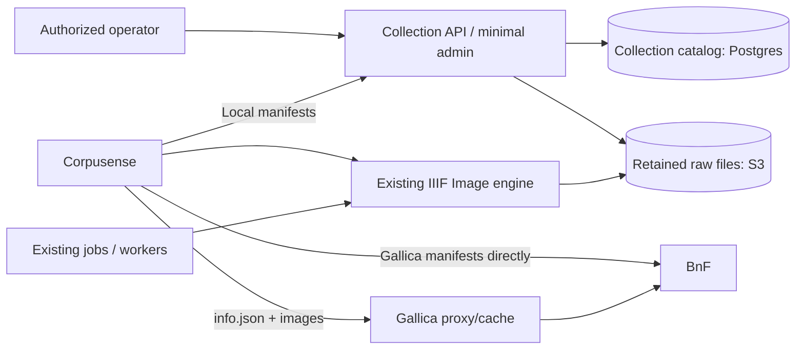

# Architecture and delivery status

**Pivot: custom collections → local IIIF → Gallica Image proxy.** Decisions
accepted 2026-11-07, plan recorded 2026-11-08. The existing job submission and
processing system remains unchanged. Start with [the workplan](WORKPLAN.md).

## Target responsibilities — planned

| Release | Deliverable | Current state |
|---|---|---|
| R1 | Restricted import/admin/API, durable raw data/catalog, publication status and provenance | Planned; first sample/import format and host details needed. |
| R2 | Generated local manifests + existing IIIF Image engine; real Corpusense/job/coordinate export | Planned; actual UI/job contract and image-engine verification needed. |
| R3 | Image-only Gallica proxy/cache; Corpusense direct manifests/internal routing | Planned; existing fetcher/transport/cache code is partial reuse. |

Existing implementation: `asset_store_core` (S3/Postgres adapters, registry,
guards, admin, lifecycle), `fetcher_service` (origin policy and authenticated
preload/cache-only facade), bulk-loader and worker simulator. They do not already
implement the collection service or a full IIIF Image API. No new service was
implemented/deployed by this plan; old package names remain for compatibility.

## Accepted limits

Public reads of approved published test collections; restricted administrative
writes. No public database/backend/admin access implied. End-user/project access,
independent service+user verification, proxy login/metering, strict worker egress,
smart resolution selection, multiple backends, tmp/task storage changes and
agentic interfaces are follow-ups. Preserve canonical sources and exact input
representation/coordinate metadata now. Retained collections are not disposable
cache entries. No universal asset-store/alias/capability platform requirement.

Use the current S3/Postgres approach; no mandatory Supabase, provider switch or
job-engine rewrite. Off-the-shelf IIIF software is to be selected against the
actual files/UI; Cantaloupe is a candidate, not a delivered component.

## Evidence and navigation

The prior code baseline recorded 542 tests passing, plus bounded cache workload
and restore/rollback evidence. Those checks were not rerun here and do not certify
new collection/UI behavior or production readiness. Preserve existing security
findings and private reports/runtime files; verify host state before reuse.

[Active specification](spec/README.md) · [ADRs](spec/03_ARCHITECTURE.md) ·
[M-002 releases](milestones/COLLECTIONS_AND_IMAGE_PROXY_PILOT.md) ·
[Collections](services/collections-service.md) · [Image proxy](services/gallica-image-proxy.md) ·
[Backlog/inputs](spec/05_BACKLOG_AND_OPEN_QUESTIONS.md) ·
[Historical programme](history/asset-store/README.md)
