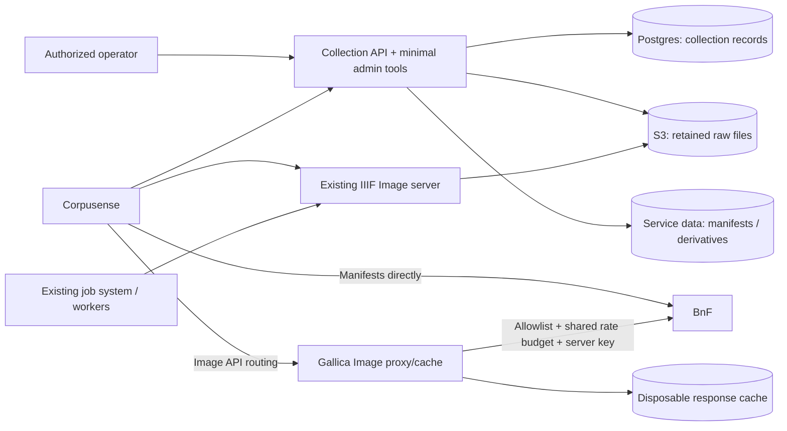

# 03 — Architecture and decisions

**Active architecture: M-002, pivot accepted 2026-11-07.** This page describes
target ownership, not delivered functionality. Existing source packages and
runtime configuration remain unchanged by the documentation pivot.

## Target architecture

Boxes are responsibilities, not mandatory services/buckets/databases. Start with
collection and proxy modules in one application if convenient, one database and
one active S3 backend. An existing IIIF Image engine handles image operations;
the collection application generates Presentation documents. Browser and worker
reachable URLs must be checked against the existing system, not assumed.

## Ownership and storage

| Owner | Authoritative data | Boundary |
|---|---|---|
| Collection application | Collection/document/page ordering, representations, publication state, source references, import status and raw locations | Raw bytes preserved as supplied; publication is read-only to users; no cache-pressure deletion of retained collections. |
| IIIF Image engine | Image transformations and disposable derivative cache | Never overwrite raw source; publication status must govern image access too. |
| Gallica proxy | Response cache/index and upstream request policy | Image API only; no Presentation proxy/manifest editing; cache is disposable. |
| Existing job system | Submission, execution, result publication/retention | Unchanged interfaces; collection/proxy supply reachable inputs and provenance metadata. |

Use buckets/prefixes and least-privilege credentials according to owning service
and data retention, not a fixed four-space global model. Shared readers need
explicit read grants, not duplicate copies. Keep backend/bucket/key as physical
location fields behind a small adapter; stable collection/page/representation IDs
must not embed a specific endpoint. Multiple backends are a necessary future
extension, not an R1 implementation or certification task.

Minimum catalog: collection, document, ordered page, representation and import
item/outcome. A representation records checksum, format, dimensions, raw location,
provenance and canonical source/coordinate frame when available. These are domain
records, not access logs or an unrestricted filesystem. Concrete schema/endpoints
are B-101/B-102 work. Do not mandate universal aliases or a capability broker.

## ADR log — active pivot

All decisions below are accepted on **2026-11-07**. Candidate software and missing
integration details remain explicitly provisional; accepting the boundary does
not certify a particular implementation.

| ID | Decision | Rationale / alternatives | Requirements / supersession |
|---|---|---|---|
| ADR-042 | Pivot to collection import → local IIIF publication → Gallica Image proxy, preserving existing job submission/processing. Freeze the general asset-store programme. | Ship user workflows instead of completing a general storage platform. Neither a rewrite nor finishing M-001 is a prerequisite. | FR-100..109, FR-120..124; replaces M-001/ADR-024 delivery priority and ADR-002 as the product boundary. |
| ADR-043 | Collection application owns catalog, publication and retained raw data; use a small S3 adapter and stable logical IDs, with service-owned storage. No mandatory universal alias/capability layer. | Naming/provenance are needed; a shared filesystem-style registry is not established as necessary. Selective reuse is allowed without locking clients to its public API. | FR-102..103/106, NFR-106; supersedes ADR-004/007/010/011 as universal new-service requirements. Existing runtime contracts are unchanged. |
| ADR-044 | Use existing IIIF Image software; generate local Presentation manifests from collection metadata in the application. | Do not implement a general image engine or manifest editor. Cantaloupe is an evaluation candidate, not an approved deployed dependency; choose against real formats/UI and record the result. | FR-104..105; local IIIF publication is now pilot scope, superseding the earlier deferral. Q-102/B-104. |
| ADR-045 | First tests: restricted operator writes/publication, public reads of approved published material, drafts/unpublished material hidden. Defer user/project login, independent service+user verification and proxy metering. | Owner accepts suitable publicly readable test material. Do not turn backend buckets/admin routes public or claim tenant privacy. Keep future membership data/access boundary possible without implementing it now. | FR-100/106, NFR-101; replaces FR-014/ADR-006/016 as blanket new-product auth contracts. Their behavior remains for reused endpoints. |
| ADR-046 | Gallica proxy is Image API only (info.json + images). Corpusense fetches Presentation directly and internally routes image requests; no server-side manifest rewriting. | UI routing avoids a Presentation proxy/editor. It must cover URLs derived from info.json as well as manifest image links. | FR-120..124; narrows the discussed proxy scope; supersedes ADR-031 cache-only/preload-only delivery restriction for R3. |
| ADR-047 | Keep upstream key server-side, validate origin/redirects, bound shared upstream demand and cache responses. Proxy-user auth and per-user accounting are later. | A URL allowlist is an origin boundary; a finite upstream budget protects shared key capacity. Reuse SSRF/transport work rather than remove it. Cache-miss fetching is needed for transparent proxying. | FR-120..124, NFR-102/105; supersedes B-025 read-through deferral for R3 only; key availability/quotas are Q-104/105. |
| ADR-048 | Separate canonical resource, representation and exact bytes. Preserve provenance/dimensions/checksum and export coordinate mapping from the start; smart local selection is follow-up. | BnF-supplied ~2048-pixel derivatives may be useful without matching full-resolution bytes/pixels. Exact Image API proxy requests must not receive silent lower-resolution substitutes. No visual/hash inference of resource equivalence. | FR-103/108..109/122; generalizes the lesson of ADR-035; ADR-014/018/035 are legacy behavior, not an automatic new-proxy equivalence policy. |
| ADR-049 | Reuse current S3/Postgres approach with one active backend. Do not add Supabase, provider migration, concurrent routing, HA or repo renaming as a delivery prerequisite. Preserve backend-independent IDs/location metadata. | Limit implementation churn; future simultaneous backends remain required follow-up. Old backend certification/spikes do not gate the collection pilot. | FR-102, NFR-106; refines ADR-001/012 without forbidding future coexistence/migration. |
| ADR-050 | Existing jobs and results remain unchanged; no new task engine, results store or tmp namespace is required now. Keep new observability and checks proportional to each release. | Supply compatible URLs and source metadata, prove a real job, and avoid imposing the old simulator protocol. Revisit staging/retention with actual task requirements. | FR-107..109, NFR-103..105; supersedes mandatory adoption of ADR-019/FR-069 and the old integration form. |

## Deferred representation policy

A later processing input resolver can require a minimum useful pixel size/scale,
rank eligible local representations, and optionally fetch the exact requested
rendition. Define what “best” means using actual processing requirements. Record
the chosen immutable representation per attempt. Density is not determined by a
single 2048-pixel label; source geometry and processing requirements matter.

For full-page scaling, map coordinates through actual dimensions/canvas placement.
Cropping, rotation, deskew or unequal source images require a supplied/recorded
transform; normalized coordinates alone are not proof of alignment. Preserve
processed-pixel coordinates and dimensions so later exports remain possible.

## Transition and existing implementation

- `asset_store_core` already provides registry, guards, S3/Postgres adapters,
  lifecycle and admin code. `fetcher_service` already provides fetching/origin
  policy and a narrow authenticated preload/cache-only API. These are reuse
  candidates, not newly delivered collection/IIIF services.
- Existing capabilities are process-local; proxy uploads buffer bytes and default
  to 50 MiB. No new streaming/resumability, public read route or Image API engine
  has been implemented by this plan.
- Do not delete registered content, remove runtime protections, rewrite migrations,
  stop monitoring/lifecycle, rename packages or recreate volumes during the pivot.
  A legacy lifecycle worker must not manage newly retained collections through
  cache eviction/TTL defaults. Review ownership/configuration before reuse.
- The actual Corpusense/job repository and first import schema remain inputs
  (Q-101/102). Do not infer their protocol from `worker-sim`.

## Prior ADRs and historical evidence

[ADR-001..041 and their original rationale](../history/asset-store/spec/03_ARCHITECTURE.md#adr-log)
are retained unchanged in the historical snapshot. The active table above states
which assumptions no longer constrain new delivery. Historical implementation and
security evidence remains valid only for the versions/workloads it actually tested.

Software references for B-104: [Cantaloupe S3/filesystem sources](https://cantaloupe-project.github.io/manual/5.0/sources.html),
[Image API endpoints](https://cantaloupe-project.github.io/manual/5.0/endpoints.html),
[IIIF manifest/image-service recipe](https://iiif.io/api/cookbook/recipe/0005-image-service/).
